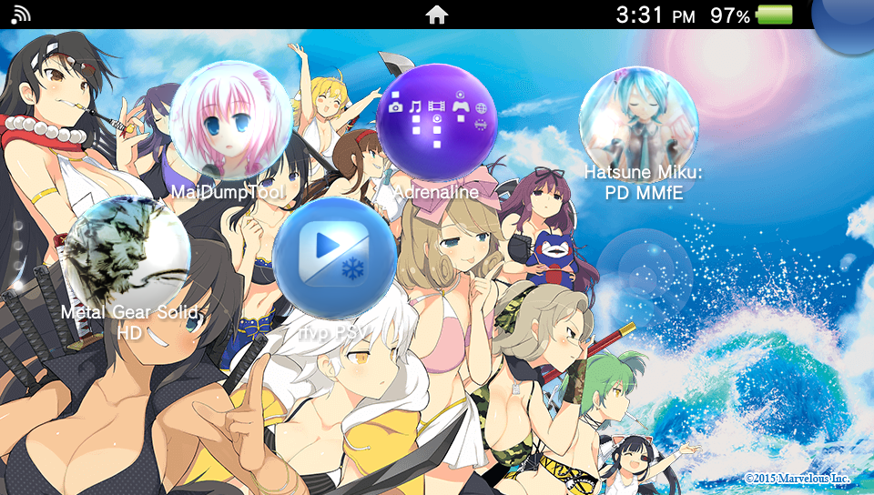
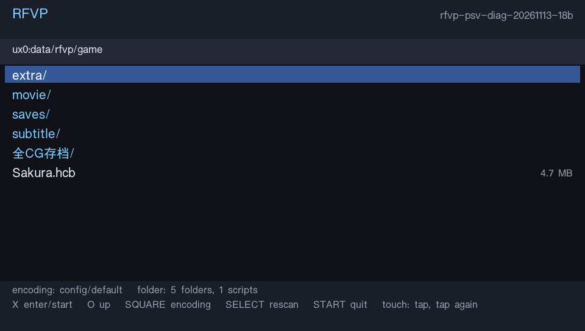

# Selecting a game on PS Vita

Open RFVP, browse to the game's folder, select its `.hcb` file, and press **X**.
The selected script's parent folder becomes the resource root: keep its BIN packs,
`default.ttf`, and optional `config.toml` there. Games do not need to be moved to a
single fixed folder. This is an FVP launcher; it does not run Kirikiri/XP3 games.

## Browser controls

| Input | Action |
| --- | --- |
| Up / Down | Select a row; hold to repeat |
| Left / Right | Page |
| X | Enter directory / start the selected script |
| Circle or L | Parent directory, stopping at the device root |
| Square | Script encoding: config/default, Shift-JIS, GBK, UTF-8 |
| Select | Rescan this directory |
| Start | Exit the browser/application |
| Touch | Select a row, then tap it again to enter/start |

The browser starts in the remembered directory, or `ux0:data/rfvp/game` for an
existing installation, and can navigate up to `ux0:`. It lists immediate children,
not the entire card recursively. Listings are bounded to 1024 entries and show a
warning when truncated. It also recognizes the legacy `.gbk` script extension.

The explicitly selected script overrides `config.toml`'s `hcb`. Explicit/remembered
encoding overrides its `nls`; otherwise the configuration or Shift-JIS default
applies. Square's `config/default` option removes the remembered override.
Translated games must use standard HCB/BIN data, following ADR-0008. This PR does
not add runtime translation tables, resource aliases, or automatic patch probing.

```toml
[game]
hcb = "translated.hcb"
nls = "gbk"
```

Settings are stored in `ux0:data/rfvp/launcher-state.txt`, keyed by full script
path. They do not rewrite scripts or game configurations. A settings write failure
is visible and does not prevent playing with the current selection. The browser
uses `ux0:data/rfvp/launcher.log`; game diagnostics remain in the selected folder.

## Font, saves, and startup failures

The browser needs a CJK font before a game is selected. It tries:

1. `ux0:data/rfvp/browser.ttf`
2. `ux0:data/rfvp/default.ttf`
3. `ux0:data/rfvp/game/default.ttf`
4. `ux0:data/rfvp/launcher.ttf`

No font is bundled. If none can be loaded, a diagnostic is written and the port
falls back to its existing fixed-folder/configured startup. Each selected game's
own `default.ttf` remains separate from the browser font.

Script/configuration startup errors return to the browser for another selection.
Before loading, held buttons and touch contacts must be released; timeout or input
read failure cancels the launch. Browser pixels, glyph cache, font and texture are
released before boot. A game that has already started still exits the application;
returning from gameplay to the browser is not implemented here.

Saves follow the selected folder's existing `saves/<game>/save/` layout. Selecting
the original `ux0:data/rfvp/game/` installation retains its save location. Moving a
game requires moving its saves with it; this launcher does not move or merge saves.

## Build and demonstrations

Run `platform/vita/build_vita.sh` with the pinned console toolchain. The optional
`RFVP_PSV_OUT_DIR` controls package staging independently of `CARGO_TARGET_DIR`.
The existing RFVP artwork is included as bubble and LiveArea assets; see ASSETS.md.

These user-provided screenshots show the local 18b device build from which the
browser was extracted. The user reported that build worked on hardware. This PR
is separately rebased on current upstream, retains upstream's session and standard
translation model, and must not be described as the identical hardware-tested binary.
Historical device coverage includes Hoshizora no Memoria and Sakura, Moyu.; no
claim is made that every route, encoding or error case was tested on hardware.




